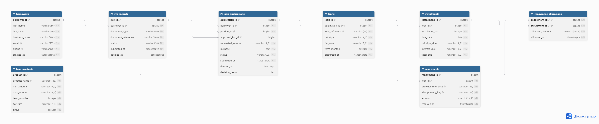

# LendBridge Database Design and Modelling

**Module:** MIT 8103 Advanced Database Systems  
**Portfolio:** Portfolio 1  
**Database:** `lendbridge_db`  
**Implementation environment:** PostgreSQL 18.6 on Windows, managed through pgAdmin 4  
**Review date:** 22 October 2026

LendBridge is a fictional Nigerian fintech used to model small business working capital loans. This portfolio implements borrower registration, KYC submissions, loan applications, approval and rejection, disbursement, instalment schedules, repayments and payment allocations.

The latest corrected test suite was executed in pgAdmin and reported **30 checks passed and 0 failed**. This is evidence for the specific cases tested, rather than certification of a production lending system.

## Case study and scope

Read the [case study](case-study.md) for actors, assumptions, product examples and business rules. Only synthetic data is used. No live payment gateway, real lending, deployed application, bank statement feed or regulatory approval is included.

The interest model is a flat rate for the full loan term. The seed products range from NGN 20,000 to NGN 10,000,000 and one to twelve months. There are no fees, compounding, penalties or revolving facilities in this portfolio.

## Entities and relationships

| Table | Purpose | Key relationships |
|---|---|---|
| `borrowers` | Business owner identity and contact details | Parent of KYC submissions and applications |
| `kyc_records` | Identity submissions and verification decisions | Belongs to one borrower; may support several application approvals |
| `loan_products` | Product amount limits, term and flat rate | Parent of applications |
| `loan_applications` | Requested principal and credit decision | One borrower and product; optional supporting KYC; zero or one loan |
| `loans` | Disbursed contract and financial term snapshots | One application; many instalments and repayments |
| `instalments` | Due dates and principal and interest obligations | One loan; zero or many allocations |
| `repayments` | Confirmed synthetic payment receipts | One loan; zero or many allocations |
| `repayment_allocations` | Amounts applied from receipts to instalments | Composite primary key `(repayment_id, instalment_id)` |

A loan can exist before its first repayment. A receipt may have unapplied cash. A schedule instalment may have no allocations, one allocation or several partial payments. These relationships must not be drawn as requiring an immediate repayment or allocation.

An application has zero or one loan; a loan has exactly one application. A KYC submission may support several applications because `approved_kyc_id` is not unique. The application can have no supporting KYC until approval.

## ER diagram



The diagram image is stored beside this README, not inside `screenshots`. Its editable source is [lendbridge.dbml](lendbridge.dbml). The nullable KYC relationship uses `ref: >? kyc_records.kyc_id` in the current DBML editor. Keep the saved DBML consistent with the exported diagram.

The disbursement procedure creates the complete schedule. The foreign key alone does not guarantee that every loan has instalments.

## Design decisions

- **Money:** `NUMERIC(19,2)` represents amounts to kobo precision. `NUMERIC(7,6)` holds fractional rates such as `0.060000` for 6% over the whole term.
- **Identity:** Primary keys use generated identity values. Failed or rolled-back inserts can leave gaps; IDs must be captured with `RETURNING`, not guessed.
- **KYC:** Lifecycle and chronology checks govern decision timestamps. The approval procedure verifies that the selected KYC belongs to the applicant and is verified.
- **Snapshots:** Principal, rate, term and application linkage are stored on `loans`. The contract trigger blocks changes to those four fields and blocks loan deletion. It does not make every loan column immutable.
- **Schedules:** Disbursement creates the loan and schedule in one transaction. The final instalment absorbs rounding residuals.
- **Derived values:** Reporting views derive outstanding debt and unapplied receipts. `instalments.total_due` is a stored generated value, documented in [normalisation.md](normalisation.md).
- **Deletion:** `ON DELETE RESTRICT` prevents removal of referenced parent rows. It does not prevent every deletion or update of financial records. Full history protection would need additional permissions and mutation controls.
- **Payment processing:** The procedure locks the parent loan and allocates receipts in instalment order. All writers must follow the same locking protocol for this protection to apply. The current direct-write trigger checks totals but does not itself take the same parent loan lock.
- **Indexes:** Primary and unique constraints create supporting indexes. Additional query performance indexes belong in Portfolio 2.

## How to run the scripts

Use the following sequence for a new project database. Database creation runs against `postgres`; the remaining files run against `lendbridge_db`.

| Order | File | Purpose |
|---|---|---|
| 1 | [00_create_database.sql](00_create_database.sql) | Create the database once |
| 2 | [01_verify_setup.sql](01_verify_setup.sql) | Inspect connection, version, encoding, timezone and search path |
| 3 | [02_create_tables.sql](02_create_tables.sql) | Create the eight tables and constraints |
| 4 | [03_procedures_and_triggers.sql](03_procedures_and_triggers.sql) | Install workflow procedures and defensive triggers |
| 5 | [04_views_and_reconciliation.sql](04_views_and_reconciliation.sql) | Create reporting and reconciliation views |
| 6 | [05_seed_data.sql](05_seed_data.sql) | Insert synthetic products, borrowers, KYC and initial applications |
| 7 | [06_constraint_tests.sql](06_constraint_tests.sql) | Run the latest corrected 30-check suite |

This README uses `06_constraint_tests.sql` as the canonical test filename. Save the latest tested contents supplied as `06_constraint_tests_corrected.sql` under that filename in the project. The obsolete `03_constraint_tests.sql` is not an alternative to the corrected suite. Do not run both.

In pgAdmin, right-click the target database, open Query Tool, open or paste a script and execute the entire file. For this installation, the successful database creation statement was:

```sql
CREATE DATABASE lendbridge_db WITH OWNER = postgres;
```

It inherits the installation defaults. The earlier explicit `C` collation conflicted with the Windows template. Update `00_create_database.sql` to the successful statement before presenting it as reproducible. Do not rerun database creation against an existing database.

`02_create_tables.sql` begins by dropping tables with `CASCADE`. It is a rebuild script and destroys existing table data and dependent views. Do not rerun it after loading data unless intentionally rebuilding the disposable project database. The original seed script assumes a fresh database with initial identity values and is not a repeatable migration. The combined `all_in_one_setup.sql` has not been reviewed here; use the separate, tested sequence above.

## Test results and interpretation

The corrected suite contains **23 rejection checks across the original 16 rule groups, plus 7 positive workflow checks**. The pgAdmin output on 22 October 2026 reported **30 PASS and 0 FAIL**.

| Test IDs | Behaviour checked |
|---|---|
| TEST-01 to TEST-06 | Duplicate email and phone; invalid product range; zero application principal; missing borrower; invalid pending KYC decision time |
| TEST-07A to TEST-07C | Pending KYC, amount outside product limits and KYC belonging to another borrower |
| TEST-08A and TEST-08B | Disbursement of submitted and rejected applications |
| TEST-09A and TEST-09B | Duplicate loan prevention through the procedure and unique constraint |
| TEST-10 | Duplicate instalment number within a loan |
| TEST-11A and TEST-11B | Zero and negative repayment amounts |
| TEST-12A and TEST-12B | Duplicate provider reference and idempotency key |
| TEST-13 and TEST-14 | Duplicate allocation pair and cross-loan allocation |
| TEST-15A and TEST-15B | Allocations exceeding receipt amount and instalment remainder |
| TEST-16 | Restrictive borrower deletion through a named borrower foreign key |
| POS-00 | Complete three-instalment schedule totalling NGN 318,000 |
| POS-01 and POS-02 | NGN 120,000 split payment, followed by NGN 92,000 clearing instalment 2 |
| POS-03 | NGN 150,000 receipt allocating NGN 106,000 with NGN 44,000 unapplied |
| POS-04 | Exact retry returns the existing receipt without changing receipt count or allocation total |
| POS-05 and POS-06 | Independently aggregated totals and fully settled instalments |

Test 16 accepts SQLSTATE `23001` or `23503`, but requires a named borrower foreign key. The observed restriction was correctly enforced; the first test expectation was too narrow.

Tests use isolated synthetic records and capture generated IDs. They intentionally roll back those records, retain the report in a session temporary table and leave sequence gaps. The seed data remains, but the positive scenario loan is not retained. Do not expect that temporary loan to appear later in the reporting views.

Reopen the report in the same Query Tool session with:

```sql
SELECT *
FROM pg_temp.lb_corrected_results
ORDER BY test_id;
```

Export the results before closing the connection because temporary reports do not survive session termination.

## Evidence

| Evidence file | What it records |
|---|---|
| [01_verify_setup.png](screenshots/01_verify_setup.png) | Initial connection and database verification |
| [02_detailed_setup.png](screenshots/02_detailed_setup.png) | Detailed setup query output |
| [03_search_path.png](screenshots/03_search_path.png) | Search path output, if saved |
| [04_create_tables_success.png](screenshots/04_create_tables_success.png) | Schema script success |
| [05_tables_list.png](screenshots/05_tables_list.png) | Eight-table listing |
| [06_procedures_triggers_success.png](screenshots/06_procedures_triggers_success.png) | Procedure and trigger script success |
| [07_views_created.png](screenshots/07_views_created.png) | Reporting view script success |
| [08_seed_data_success.png](screenshots/08_seed_data_success.png) | Seed data transaction success |
| [09_constraint_tests_passed.png](screenshots/09_constraint_tests_passed.png) | Final test output with 30 passed and 0 failed |
| [constraint_test_results.csv](screenshots/constraint_test_results.csv) | Exported complete test results |

The setup, schema, procedures, views, seed data and final test output were shown during the walkthrough. The exported CSV was reported saved but its contents have not been independently read in this review. Verify the evidence filenames on disk before submission; `03_search_path.png` was requested but was not visible in the supplied expanded screenshots folder. Do not claim that screenshot exists until saved.

## Normalisation

Read [normalisation.md](normalisation.md) for the worked UNF, 1NF, 2NF and 3NF explanation. It uses a consistent allocation key and distinguishes historical contract facts from the deliberately stored generated total.

## Reflection and remaining work

The walkthrough exposed fixed-ID assumptions, application/loan variable reuse and test ordering problems. Capturing IDs and setting up isolated fixtures made the tests repeatable without recreating the schema. It also showed why a test must check the intended error and why unexpected success must be rolled back.

Further work includes two-session concurrency testing, controlled roles and privileges, protection of payment and allocation history against direct mutation, more complete idempotency conflict checks and independent reconciliation evidence. Balance views reduce duplicated state, but they cannot repair incorrect source rows. The supplied schema is a loan-servicing model, not a complete debit-and-credit general ledger.

Before submission, add the student's own explanation and reflection, confirm screenshot links and the diagram, check the actual Git history and push to the private course repository. No Git commit or push has been independently verified in this review; do not invent historical commits.

## AI use declaration

ChatGPT helped develop the alternative LendBridge case study, prepare the initial project guide, explain pgAdmin operations, diagnose test failures, revise the SQL tests and review the documentation. Antigravity with Gemini was used to generate the initial implementation and documentation. The scripts were executed in pgAdmin, errors were investigated and the latest corrected suite reported 30 passing checks. AI-generated material remains subject to student review and explanation. The student should add their own name and describe any further changes and verification they personally completed before submission.
