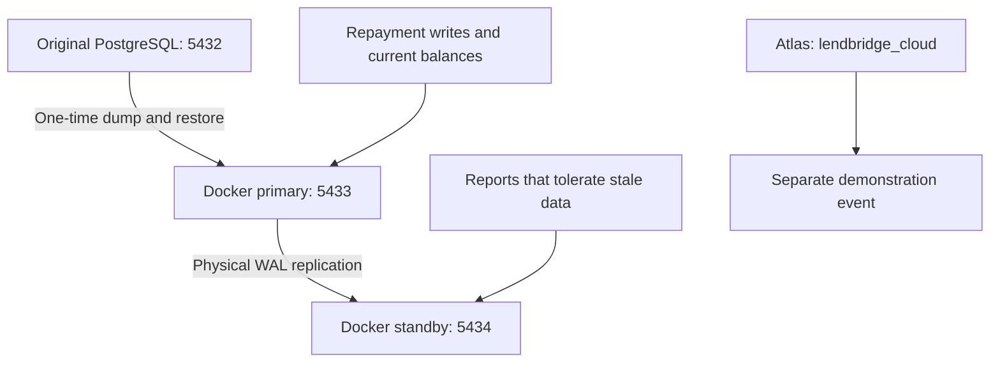

# Portfolio 5: LendBridge Distributed and Cloud Databases

## 1. Architecture and workload routing

This portfolio investigates PostgreSQL streaming replication, stale reads, synchronous acknowledgement, partitioning and manual failover. It also demonstrates a majority write and secondary read on MongoDB Atlas.

The experiments use a Docker copy of `lendbridge_db`. The original PostgreSQL database on localhost port 5432 remains separate.

The diagram shows the topology before failover. After manual promotion, the container named `lendbridge-pg-replica` became writable. The original primary remains stopped to prevent two independent writers.

### Recorded environment

| Component | Recorded version or configuration |
|---|---|
| Docker Desktop | 4.97.0 |
| Docker Compose | v5.6.1 |
| Docker PostgreSQL | 18.6 |
| Docker image | `postgres:18` |
| MongoDB Atlas | 8.0.34 |
| MongoDB Shell | 2.14.0 |
| Atlas cluster | ADSMivaAz, Free tier |
| Atlas region | AWS Paris, eu-west-3 |

The exact running PostgreSQL image ID is recorded in `output/08_environment.txt`.

### Data used

| Dataset | Rows |
|---|---:|
| Borrowers | 5,000 |
| Loans | 50,000 |
| Repayments | 200,000 |

The repayment amount total was **11,200,000,000.00**. Matching counts and totals were checked across the original and replicated Docker datasets.

PostgreSQL remains the proposed financial authority for LendBridge. Repayment posting, confirmation and current balance decisions should use the active primary. Background reports may use a standby where the business accepts and communicates possible staleness.

The Atlas event was inserted separately for this experiment. No automatic integration between PostgreSQL and Atlas was implemented.

Evidence: `screenshots/01_docker_ps.png`, `screenshots/02_row_counts.png` and `output/08_environment.txt`.

## 2. Replication and consistency

The standby was initialised using `pg_basebackup` and received physical WAL from the primary. The setup used the replication role `lb_replicator`, application name `lendbridge_replica` and physical replication slot `replica1_slot`.

Before failover, the primary showed a streaming connection with `sync_state=async`. The slot was active. The standby reported recovery enabled and read-only transactions. An attempted UPDATE was rejected as expected.

### Deliberately stale reads

After confirming that replay was paused on the standby, I inserted a second replication marker on the primary. The primary contained two markers while the standby still contained one. After replay resumed, both markers became visible on the standby.

This demonstrated that a running replica can return older data. A successful primary write does not make an asynchronous standby immediately current.

### Synchronous acknowledgement

I configured the primary to require acknowledgement from `lendbridge_replica`. With the standby available, the connection showed `sync_state=sync`.

After stopping the standby, another INSERT waited. A separate session showed the `SyncRep` wait event. Cancelling that wait produced a warning that the transaction had committed locally but might not yet have replicated.

The warning matters because cancellation did not establish that the write failed. Retrying a financial operation without checking its outcome could create a duplicate. I restored asynchronous configuration, restarted the standby and verified that all four markers were present.

For production repayment posting, I would require durable acknowledgement from a synchronous standby in a separate failure domain, use unique idempotency keys and reconcile uncertain outcomes before retrying. This policy increases acknowledgement latency and can delay successful responses when the required standby is unavailable. Current balance and confirmation reads would remain on the active primary.

The stopped-standby experiment illustrates an availability trade-off. It does not establish complete CAP behaviour or prove linearizability.

Evidence: `screenshots/03_primary_checks.png` through `screenshots/09_sync_recovered.png`.## 3. Partitioning and distributed design

I created `lb_p5.repayments_by_loan` as a reporting copy, hash partitioned by `loan_id` into four partitions. Its primary key combines `loan_id` and `repayment_id`.

### Data validation

| Dataset | Rows | Total amount |
|---|---:|---:|
| Original repayments | 200,000 | 11,200,000,000.00 |
| Four-partition copy | 200,000 | 11,200,000,000.00 |

| Partition | Rows |
|---|---:|
| repayments_p0 | 50,144 |
| repayments_p1 | 49,892 |
| repayments_p2 | 50,036 |
| repayments_p3 | 49,928 |

### Query plans

| Filter | Partitions accessed | Access method | Execution time |
|---|---|---|---:|
| loan_id = 100 | repayments_p1 only | Bitmap heap/index scan | 0.275 ms |
| repayment_id = 100 | All four partitions | Sequential scans under Append | 23.970 ms |

The loan-key query demonstrated partition pruning. The repayment-ID query lacked the partition key and scanned all four partitions. The timing difference also reflects different index access methods, so it cannot be attributed entirely to pruning.

The reporting copy does not reproduce every constraint of the financial source. In particular, its composite primary key does not establish global uniqueness of repayment IDs or idempotency keys.

### Proposed distributed design

For a future distributed LendBridge deployment, I would evaluate `loan_id` as the shard key because most repayment and instalment operations relate to a specific loan. Loan, instalment and repayment records should be colocated so that routine posting and allocation can complete within one shard. Hash distribution could spread many loans across servers, although a heavily used loan could still create a hotspot.

Operations covering several loans would require explicit coordination. Financial invariants must remain atomic where required; a distributed transaction would need a coordinator and a recovery procedure. Compensating business actions would need separate reconciliation rules.

Global idempotency would also need deliberate design. A unique constraint containing `loan_id` would not prevent the same provider reference or idempotency key appearing on different shards. An authoritative deduplication service or globally coordinated registry would need to reserve each key consistently with posting.

Reports without `loan_id` could require requests to every shard. A separate reporting pipeline could reduce that operational load while making its freshness explicit.

The PostgreSQL partitions in this experiment remain on one server and provide no additional failure domains. MongoDB sharding would distribute documents across shards, each potentially replicated. The Atlas replica set tested here duplicates data across members; it does not demonstrate sharding.

Evidence: `04_partitioning.sql`, `output/04_partitioning.txt`, `output/04_plan_loan_id.txt`, `output/04_plan_repayment_id.txt` and screenshots 10–12.

## 4. Failover and recovery

Before stopping the original primary, I checked the replication position. The primary WAL position and standby replay position were both `0/DF161F0`, with a recorded replay gap of zero bytes.

I stopped `lendbridge-pg-primary` and manually promoted `lendbridge-pg-replica`. After promotion:

- `pg_is_in_recovery()` returned false.
- `transaction_read_only` was off.
- A new marker, `write after manual promotion`, was inserted successfully.
- All four pre-failover markers remained present.

The new marker received ID 36. Gaps in an identity sequence do not, by themselves, demonstrate missing committed rows.

### Recovery measurement

| Observation | Recorded result |
|---|---|
| Pre-stop replay gap | 0 bytes |
| Pre-failover markers retained | 4 of 4 |
| Write after promotion | Successful |
| Manual recovery elapsed time | 181.77 seconds |

The elapsed time includes manual commands and pauses for screenshots. It is an observed lab recovery duration, not an automated failover benchmark or a guaranteed production RTO.

No loss was observed among the four checked markers. This limited test does not prove zero data loss for every transaction or every asynchronous failure scenario.

### Fencing and further recovery

The original primary remains stopped. Restarting it as an independent writable server could create split brain. It must be deliberately reconciled or rebuilt as a standby before rejoining the topology.

Production recovery would also require controlled connection routing, independent failure domains, monitoring and tested failover procedures. Replication alone does not protect against accidental deletion or replicated corruption. Tested backups and archived WAL for point-in-time recovery would be additional requirements; these were not demonstrated in this lab.

Evidence: `output/05_failover.txt`, `screenshots/13_before_failover.png`, `screenshots/14_promoted_replica_write.png` and `screenshots/15_failover_markers.png`.## 5. Cloud deployment

I connected MongoDB Shell to the existing Atlas cluster `ADSMivaAz` and used the separate database `lendbridge_cloud`.

The recorded topology contained one primary and two secondaries in AWS Paris (`eu-west-3`). The replica set name was `atlas-wnjnv7-shard-0`. All three members were in the same region, so this experiment did not demonstrate multi-region resilience.

### Majority write and secondary read

I inserted a demonstration repayment event with ID `p5-majority-demo-01`, using:

- Write concern: `w: "majority"`.
- Write acknowledgement timeout: 10,000 milliseconds.
- Amount: Decimal128 `56000.00`.
- Currency: `NGN`.

The INSERT returned `acknowledged: true`.

I then queried the event with read preference `secondary` and read concern `majority`. The query returned the document successfully. The shell prompt continued to display the primary connection, but the query explicitly requested a secondary.

The saved evidence records the requested read preference and returned document. It does not identify which individual secondary served the query. This limits the serving-host evidence.

### Security and limitations

The connection used Atlas TLS, a database user and an IP access list. An initial connection failed with a TLS/server-selection error. After checking the access list and retrying, the connection succeeded. The exact cause of the initial failure was not conclusively established.

The observed cluster used the Free tier. Its overview showed backup inactive and monitoring paused before connection. I did not configure backups or test an Atlas failover. This was a replica-set demonstration; no MongoDB sharded cluster was deployed.

The reusable `06_atlas_demo.js` uses an upsert with the same demonstration ID to avoid creating duplicate events on repeated runs. The original recorded experiment used an INSERT.

Evidence: `output/06_atlas_verification.json` and screenshots 16–19.

## 6. Individual extension and limitations

### Question

Would increasing the number of hash partitions from four to eight change data distribution and the query plan for a lookup by `loan_id`?

### Method

I created `lb_p5.repayments_by_loan_8`, copied the same 200,000 repayments into eight hash partitions and ran ANALYZE. I checked counts and totals, performed a preliminary count query for `loan_id = 100` on each table, and captured EXPLAIN ANALYZE plans for the same lookup.

### Results

| Measurement | Four partitions | Eight partitions |
|---|---:|---:|
| Rows | 200,000 | 200,000 |
| Total amount | 11,200,000,000.00 | 11,200,000,000.00 |
| Rows returned for loan 100 | 4 | 4 |
| Partitions accessed | 1 | 1 |
| Planning time | 0.232 ms | 0.275 ms |
| Execution time | 0.670 ms | 0.097 ms |
| Shared buffer hits | 6 | 6 |

The eight-partition row counts were 24,960; 25,228; 25,256; 24,784; 25,184; 24,664; 24,780; and 25,144.

Both plans pruned to one partition and used bitmap heap/index scans. Eight partitions produced smaller individual partitions while preserving the checked row count and total.

The eight-partition query was faster in this recorded run, but one observation does not establish a reliable performance improvement. Cache state, background activity and page state can affect timings. The four-partition plan also reported four dirtied heap pages. Repeated trials with controlled conditions would be needed before recommending a partition count.

Evidence: `07_extension.sql`, `output/07_extension.txt`, `screenshots/20_extension_query_plans.png` and `screenshots/21_extension_counts.png`.

### Overall limitations

- Both Docker servers ran on one laptop and shared its failure domain.
- There was only one PostgreSQL standby.
- Failover and connection selection were manual.
- Lab commands used the PostgreSQL superuser and coursework demo passwords.
- TLS was not configured for the Docker PostgreSQL lab; Atlas connections used TLS.
- Backup restoration and point-in-time recovery were not demonstrated.
- PostgreSQL partitioning remained on one server.
- Atlas replication was confined to one region.
- No application integration, distributed monetary transaction or automatic PostgreSQL-to-Atlas synchronisation was implemented.

## 7. Reproduction, reflection and AI use

### Execution order

The detailed setup and manual experiment commands are retained in `LendBridge_Portfolio_5_Guide.md`. The completed sequence was:

1. Create the Docker setup using `docker-compose.yml`, `primary-init/01_replication.sh` and `replica-entrypoint.sh`.
2. On a fresh lab topology, start the primary and standby and verify their health.
3. Dump the existing source database and restore it once into the Docker primary. Preserve the original source database.
4. Check row counts, primary replication state and standby read-only behaviour.
5. Pause standby replay, insert a marker on the primary, compare results and resume replay.
6. Enable synchronous acknowledgement, observe the wait with the standby stopped, cancel the waiting backend and preserve the uncertain-outcome warning. Restore asynchronous configuration and verify catch-up.
7. Run `04_partitioning.sql` once and capture the loan-key and repayment-ID query plans.
8. Record replication positions, stop the original primary, promote the standby and verify marker survival and a new write.
9. Connect mongosh to Atlas, inspect topology, perform the majority write and query a secondary.
10. Run `07_extension.sql` once on the promoted PostgreSQL server and compare four and eight partitions.

The supporting checks are saved as `01_primary_checks.sql` and `02_replica_checks.sql`. Their role-specific expectations apply before promotion. The replica check intentionally attempts an UPDATE that should fail on an unpromoted standby.

### Safe rerun rules

The current lab is already promoted. Keep the original primary stopped. Do not run `docker compose up -d` for the complete old topology until it has been deliberately rebuilt.

Do not repeat the database restore or partition-creation scripts against the completed lab. They are not general-purpose reset scripts. Preserve the existing outputs before undertaking any new experiment.

Use PowerShell for Docker and file commands, psql for SQL, and mongosh for MongoDB JavaScript. The shell prompt itself is not part of a command.

### Evidence index

| Experiment | Main evidence |
|---|---|
| Database restore | `output/00_restore.txt` |
| Initial topology and replication | Screenshots 01–04 |
| Stale reads and catch-up | Screenshots 05–06 |
| Synchronous wait and recovery | Screenshots 07–09 |
| Four-partition validation | `output/04_partitioning.txt` and screenshot 10 |
| Partition query plans | `output/04_plan_loan_id.txt`, `output/04_plan_repayment_id.txt` and screenshots 11–12 |
| Manual failover | `output/05_failover.txt` and screenshots 13–15 |
| Atlas verification | `output/06_atlas_verification.json` and screenshots 16–19 |
| Individual extension | `output/07_extension.txt` and screenshots 20–21 |
| PostgreSQL version and image ID | `output/08_environment.txt` |

Screenshots preserve observations from the live experiments. Supporting scripts saved afterwards document reusable checks; their later creation is not a claim that they generated the earlier screenshots.

### Reflection

The synchronous replication experiment changed how I interpret a cancelled database command. I initially expected cancellation to mean that the INSERT had failed. The warning showed why that assumption is unsafe: the write could already be committed locally while its replication acknowledgement remained unresolved. For LendBridge, checking the outcome and enforcing idempotency would be essential before retrying a repayment.

A practical difficulty was keeping PowerShell, SQL and MongoDB commands in the correct shell. I also encountered a PowerShell command-pasting error while converting output files. Running the corrected command separately resolved it, and I verified the saved text through Git.

I learned to separate evidence from broader claims. Matching markers supported the observed failover result, but did not prove a universal zero-loss guarantee. Similarly, a faster query in one extension run did not establish that eight partitions would always outperform four.

My next improvement would be to automate repeatable measurements and evidence capture, then test recovery with independent server failure domains and verified backups.

### AI assistance disclosure

I used ChatGPT to help adapt the LendBridge guide, draft commands and supporting scripts, interpret errors and query plans, and organise this README. I executed the commands on my own computer and captured the outputs and screenshots used here.

The implementation and write-up were developed with assistance. Performance timings, marker counts and recovery observations came from the recorded experiments; they were not generated as substitute results.